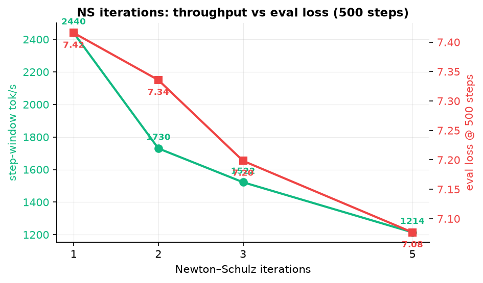

# Cyano Train Research

[](LICENSE)
[](https://www.python.org)
[](https://pytorch.org)
[](#external-hardware-smoke-record)

> 面向 0.5B 参数语言模型的训练研究框架 — 聚焦吞吐测量、checkpoint 可靠性、数据治理，以及 Muon / AdamW 优化器的严格对照实验。

---

## 概览

本项目记录了在海光 DCU Z200SM_80 上围绕约 542M 参数 dense 模型开展的训练优化研究。我们不追求 SOTA 复现，而是把每一个优化决策都建立在**可测量的对照实验**之上。

---

## 为什么值得关注

### 1 · 优化器选择是可测量问题

同一模型、同一语料下，AdamW batch 3 相比 Muon batch 2 提升约 97% 吞吐，且在约 205K tokens 的对照中同时取得更低 loss。优化器不是"凭感觉选"，而是用同 token、同 eval 窗口的 A/B 来判定。

### 2 · Checkpoint 是一等公民

双槽位提交、manifest 原子切换、per-rank 保存、旧格式兼容读取、磁盘空间不足时的一致失败，以及恢复契约对数据 SHA 的校验。训练中断后能从确定状态续跑，而不是"大概能恢复"。

### 3 · 语料是需要审计的资产

按内容 SHA-256 去重、显式批准策略、真实哈希与文件大小校验、域目录内路径限制、混合后全局打乱。清单不是"文件列表"，而是可追责的数据凭证。

---

## 项目状态

| 能力 | 状态 | 备注 |
|------|------|------|
| Muon 训练路径 | ✅ 可用 | 模型 + 优化器 + checkpoint |
| CPU 单步训练与恢复 | ✅ 测试通过 | 端到端验证 |
| DCU 单卡 / 多卡 smoke | ✅ 外部记录 | 非仓库测试 |
| AdamW 路径 | ⚠️ 依赖缺失 | 需 `model_champion.py` 与专用内核 |
| 正式规模吞吐与收敛质量 | ⏳ 未完成 | 见路线图 |

---

## 目录

- [快速开始](#快速开始)
- [已记录的实验结果](#已记录的实验结果)
- [与同平台公开工作的关系](#与同平台公开工作的关系)
- [外部硬件 smoke 记录](#外部硬件-smoke-record)
- [数据格式与安全](#数据格式与安全)
- [路线图](#路线图)
- [许可证](#许可证)

---

## 快速开始

### 安装

```powershell
python -m pip install numpy torch
```

DCU / GPU 环境需安装与加速器和驱动匹配的 PyTorch 构建，不能用 CPU wheel 替代。

### 运行测试

```powershell
python -m unittest discover -s tests -v
```

### 训练短跑

准备与模型词表匹配的 `uint32` token 文件后：

```powershell
python src/cyano_train.py `
  --optimizer muon --config smoke `
  --data .\train.bin --logdir .\logs `
  --steps 2 --max_run_steps 1 `
  --batch_size 1 --seq_len 8 `
  --warmup 1 --eval_every 0 `
  --save_every 0 --ckpt .\smoke.pt `
  --ckpt_save_optimizer 0
```

> `smoke` 使用 128-token 小词表，仅验证代码、loss、Muon 更新和 checkpoint 流程，**不适用于真实语料或质量评估**。

---

## 已记录的实验结果

> 以下为特定 DCU 集群、模型配置和短程测试的研究记录，**不是跨硬件基准排名或质量结论**。

### 吞吐总览

| 实验 | 结果 | 限制 |
|------|------|------|
| 4 Pod、AdamW、batch 3 | ~10.8–11.0K token/s | 短测；非端到端吞吐 |
| 3 Pod NCCL、200 步 Muon | ~2247 tok/s aggregate，0 skips | 扩展效率 64% |
| 单 Pod、AdamW、batch 3 | ~2.1K tok/s 早期基线 | 计时窗口不同 |

### 优化器严格对照

| 优化器 | final loss | eval_loss | tok/s | wall_s |
|--------|-----------:|----------:|------:|-------:|
| Muon | **6.4118** | **7.4376** | 1165 | 351.67 |
| AdamW | 6.7465 | 7.9818 | **1637** | 250.15 |

**结论**：严格同配置下，AdamW 快约 40%，但 loss 更高。是否接受这个权衡取决于任务优先级。

### Muon Newton–Schulz 权衡曲线



| NS | final_loss | eval_loss@500 | tok/s | step_s |
|---:|-----------:|--------------:|------:|-------:|
| 1 | 6.7679 | 7.4157 | **2440** | 0.84 |
| 2 | 6.7014 | 7.3356 | 1730 | 1.16 |
| 3 | 6.5405 | 7.1983 | 1522 | 1.25 |
| 5 | **6.4014** | **7.0768** | 1214 | 1.58 |

### 多卡扩展性

| 指标 | 单卡 | 3 卡 | 扩展效率 |
|------|-----:|-----:|---------:|
| per-rank tok/s | 1165 | 749 | — |
| aggregate tok/s | 1165 | 2247 | **64%** |

64% 的扩展效率与跨节点带宽限制一致。3 卡全部 200 步完成、0 skips。

---

## 与同平台公开工作的关系

**直接可比的同平台训练基准目前是空白。** 海光 DCU 上公开的基准工作几乎都集中在推理侧：

| 项目 | 方向 | 与本仓库关系 |
|------|------|-------------|
| `lutianshu824/dcu-bench` | vLLM 推理扫描 | 不同问题域 |
| `tuan4743/Qwen-DCU-optimization` | Qwen vLLM 优化 | 不同问题域 |
| `mengshi02/nano-vllm-hal` | 硬件抽象层 | 互补 |
| `sibadaaa/llm-engine-probe` | 推理逐层探测 | 方法论可参考 |

本仓库的差异化在于**训练侧实测基线、优化器对照和可恢复性验证**——这是公开 DCU 工作中仍然稀缺的部分。

---

## 外部硬件 smoke 记录

2026-10-31 在 Z200SM_80、PyTorch 2.9.0 环境完成：

- `smoke` 配置：1-rank 单步训练与恢复、2-rank NCCL 训练与恢复
- `dense05b` 配置：1-rank 与 2-rank 单步训练

> 分布式恢复要求所有 rank 能读取同一 manifest 与各自 rank 文件；Pod 私有 `/tmp` 不满足，需使用共享存储。

---

## 数据格式与安全

- 训练数据为**小端序 `uint32`** token ID 序列
- 清单构建与混合阶段校验分片的**真实 SHA-256、文件大小和域目录内路径**
- `torch.load(..., weights_only=False)` 与 `pickle.load` 仅用于可信本地文件，**不要加载来源不明的下载文件**

---

## 路线图

### 已完成

- ✅ 单卡 / 多卡训练与 checkpoint 恢复链路
- ✅ 优化器与 batch 的短程 A/B 基线
- ✅ 语料去重、批准与完整性校验
- ✅ CPU 端到端测试与 DCU smoke 验证

### 进行中

- 🔄 AdamW 与 Muon 的长程、同 token、同恢复对照
- 🔄 同构多 Pod 稳定性验证
- 🔄 中文高质量语料补全与污染评测

### 待探索

- 🔮 可用 fused attention kernel（当前 SDPA 回退 math backend）
- 🔮 改变模型架构以提高训练效率

---

## 许可证

本仓库代码按 [MIT License](LICENSE) 发布。第三方代码、模型、数据和自定义内核不随仓库授权，使用者应确认其贡献者与来源归属。
